# ScholarOS

<div align="center">

[](https://python.org)
[](RELEASE_NOTES.md)
[](LICENSE)
[](tests/)
[](https://mypy.readthedocs.io/)
[](https://docs.astral.sh/ruff/)

**A modular, multi-agent AI research operating system orchestrating local language models, hybrid retrieval-augmented generation (RAG), domain tools, and scientific literature workflows.**

[Documentation](docs/index.md) • [Release Notes](RELEASE_NOTES.md) • [Changelog](CHANGELOG.md) • [Installation](docs/user/installation.md) • [Architecture](docs/architecture/reference.md) • [Contributing](CONTRIBUTING.md) • [Security](SECURITY.md)

</div>

---

## 🌟 Overview

**ScholarOS** is an open-source, local-first research platform designed for scientific literature discovery, synthesis, paper analysis, and experiment management. It provides an extensible microkernel architecture connecting domain services, hybrid retrieval, offline local LLM inference (via Ollama), frontier cloud models (OpenAI, Anthropic Claude, Google Gemini, OpenRouter), and a modern desktop user interface.

Whether analyzing thousands of PDF papers, decomposing multi-step research hypotheses, or running fully private local AI sessions without internet access, ScholarOS gives researchers complete data sovereignty, verifiable citations, and sub-millisecond retrieval performance.

---

## 🚀 Key Capabilities

- **🔒 Local-First & 100% Private**: Run models locally with Ollama (`qwen2.5:1.5b`, `llama3.2:3b`, `deepseek-r1:1.5b`). Zero sensitive research data or telemetry leaves your machine unless you explicitly configure external cloud providers.
- **⚡ Hybrid RAG Engine**: Fuses lexical keyword matching (BM25) with dense vector embeddings (cosine similarity) via Reciprocal Rank Fusion (RRF), backed by an $O(N \log k)$ heap-based vector store and sub-millisecond (< 0.1ms) LRU/TTL retrieval caching.
- **🔬 Autonomous Multi-Stage Research**: Decomposes complex inquiries into structured sub-tasks, queries the literature, tracks full academic citation graphs via `CitationManager`, and generates synthesized Markdown research reports.
- **🤝 Multi-Agent Collaboration Subsystem**: Coordinates specialized autonomous agents with structured message passing, consensus mechanisms, and multi-perspective research reviews.
- **📚 Universal Knowledge Library**: Ingests PDF, Markdown, Plain Text, and JSON documents with configurable sliding-window chunking, metadata extraction (DOI, title, authors), and instant vector reindexing.
- **🖥️ Native Desktop GUI Application**: Built with Python Tkinter and zero bloated web runtimes:
  - **Telemetry Dashboard (Home)**: Live 4-card status metrics for active research projects, AI health, knowledge collections, and plugins.
  - **AI Chat Studio**: Multi-turn `AISession` tracking, real-time non-blocking response streaming, structured citation cards, and explicit provider status.
  - **Research Studio**: Interactive workflow orchestrator visualizing real-time stages (`Planning` → `Retrieval` → `Analysis` → `Synthesis`) with responsive cancellation propagation.
  - **Dual-Pane Knowledge Library**: Treeview document navigator, interactive chunk/metadata inspector, file and text ingestion, and asynchronous vector search.
  - **Plugins & Settings**: Live permission auditing, computational tool toggling, LLM provider selection, temperature/token controls, and RAG tuning.
  - **5-State Execution Status Bar**: Main-thread status coordinator tracking `IDLE`, `RUNNING`, `COMPLETED`, `CANCELLED`, and `FAILED` lifecycles driven by `EventBus` events.
  - **Non-Blocking Architecture**: Background `ThreadPoolExecutor` workers keeping the user interface fluid and responsive at 60 FPS.
- **🧩 Sandboxed Plugin Framework**: Secure, capability-permissioned plugin sandbox (`PluginManifest`, `PermissionSet`, `PluginSandbox`) for computational tools and custom domain adapters.
- **🛡️ Enterprise Security & Observability**: Context-framed prompt injection defenses, XML isolation boundaries, path traversal mitigations, secret-redacting logging, distributed `TraceContext`, and latency percentile telemetry.

---

## ⚡ 60-Second Quickstart

### 1. Install ScholarOS

```bash
# In a Python 3.12+ virtual environment:
pip install scholaros
```

Or install with development dependencies:

```bash
git clone https://github.com/scholaros/scholaros.git
cd scholaros
pip install -e ".[dev]"
```

### 2. Initialize Your Environment

```bash
scholaros init
```
This automatically bootstraps your platform-standard directories (Windows `%LOCALAPPDATA%` / `%APPDATA%`, Linux XDG, macOS Application Support) and generates your initial `config.toml`.

### 3. Launch ScholarOS

#### Option A: Desktop GUI
```bash
scholaros gui
# Or use the zero-console Windows desktop launcher:
scholaros-desktop
```

#### Option B: Terminal Research Query
```bash
scholaros run "What are the latest advancements in quantum error correction?"
```

#### Option C: System Status & Diagnostic Check
```bash
scholaros status
```

---

## 🖥️ Desktop GUI Workspace Tour

ScholarOS includes a native desktop application designed for scientific workflows:

```
┌─────────────────────────────────────────────────────────────────────────────┐
│ ScholarOS v1.0.0                                          [_][□][X]         │
├──────────────┬──────────────────────────────────────────────────────────────┤
│ 🏠 Home      │  [ Active Projects: 12 ]       [ AI Health: Ollama Online ]  │
│ 💬 Chat      │  [ Indexed Chunks: 8,420 ]     [ Loaded Plugins: 4 Active ]  │
│ 🔬 Research  ├──────────────────────────────────────────────────────────────┤
│ 📚 Library   │  Research Studio: "Quantum Error Correction Algorithms"      │
│ 🧩 Plugins   │  Status: [ Synthesis ] ━━━━━━━━━━━━━━━━━━━ 85%              │
│ ⚙️ Settings   │  • Stage 1: Problem Decomposition ................... [DONE] │
│              │  • Stage 2: Literature Retrieval (24 papers) ........ [DONE] │
│              │  • Stage 3: Comparative Analysis .................... [DONE] │
│              │  • Stage 4: Synthesis & Citation Graph .............. [RUN]  │
├──────────────┴──────────────────────────────────────────────────────────────┤
│ Status: RUNNING | Model: qwen2.5:1.5b (Local) | Latency: 18ms | Heap: 42MB   │
└─────────────────────────────────────────────────────────────────────────────┘
```

1. **Home Dashboard**: Panoramic workspace telemetry displaying active research sessions, AI provider connection status, library document/chunk statistics, and enabled plugins.
2. **AI Chat Studio**: Interactive conversation studio with multi-turn session persistence, source grounding, live citation previews, and direct RAG querying.
3. **Research Studio**: End-to-end autonomous research orchestration with real-time stage progression (`Planning`, `Retrieval`, `Analysis`, `Synthesis`), background cancellation, and exportable Markdown synthesis reports.
4. **Knowledge Library**: Dual-pane document browser featuring interactive tree navigation, raw text/chunk inspection, one-click PDF/TXT/MD/JSON document ingestion, and live vector similarity search.
5. **Plugins & Settings**: Auditable permissions viewer, dynamic tool toggling, LLM provider selection (Ollama, OpenAI, Anthropic, Gemini, OpenRouter), and granular RAG configuration.

---

## 💻 Command-Line Interface (CLI)

The `scholaros` CLI provides a unified command center for terminal-based workflows, automated pipelines, and system administration:

| Command | Description |
|---|---|
| `scholaros init` | Initializes platform directories, workspace paths, and creates starter `config.toml` |
| `scholaros gui` | Launches the interactive desktop application |
| `scholaros-desktop` | Zero-console Windows desktop launcher (`pythonw.exe` entrypoint) |
| `scholaros run "<query>"` | Executes an autonomous research pipeline query and prints the synthesized report |
| `scholaros config` | Views, inspects, or updates runtime configuration settings |
| `scholaros status` | Checks health of local/remote AI providers, retrieval caches, and vector stores |
| `scholaros info` | Displays version details, platform directories, and environment paths |

---

## 🏛️ System Architecture

ScholarOS is built on a strict 4-layer microkernel architecture enforcing clean separation of concerns and dependency injection:

```mermaid
flowchart TD
    subgraph UI ["Layer 4: Presentation & User Workspaces"]
        Desktop["Desktop GUI (Tkinter)\n• Home Telemetry Dashboard\n• AI Chat & Citation View\n• Research Studio (Live Stages)\n• Dual-Pane Knowledge Library\n• Plugin & Settings Managers\n• 5-State Status Bar Coordination"]
        CLI["CLI Commands\nscholaros {init, gui, run, config, status, info}\nscholaros-desktop"]
    end

    subgraph Domain ["Layer 3: Research & Domain Subsystems"]
        AI["AI Subsystem\n(Ollama, OpenAI, Anthropic, Gemini, OpenRouter)"]
        Research["Research Engine\n(Planner, Workflow Engine, Sessions, Citations)"]
        Collab["Multi-Agent Collaboration\n(Coordination, Message Passing, Consensus)"]
        RAG["RAG Subsystem\n(Hybrid RRF, Query Expansion, Context Framing)"]
        Knowledge["Knowledge Library\n(PDF, Markdown, Text, JSON Parsers & Chunkers)"]
        VectorStore["Embeddings & InMemoryVectorStore\n(O(N log k) Heap Search, Reciprocal Norm Cache)"]
    end

    subgraph ServiceBus ["Layer 2: Services, Coordination & Security"]
        Services["Service Registry & Health Supervision"]
        EventBus["Asynchronous EventBus (Publish / Subscribe)"]
        Plugins["Sandboxed Plugin Manager & Tool Registry"]
        Security["Security Defenses (Prompt Injection, Path Traversal, Credential Redaction)"]
        Observability["Observability (Distributed TraceContext, RAG Tracing, Structured Logs)"]
    end

    subgraph Microkernel ["Layer 1: Microkernel & Bootstrap"]
        Bootstrap["Composition Root (bootstrap_runtime)"]
        Kernel["ScholarOS Microkernel"]
        DI["Dependency Injection Container"]
        Lifecycle["Component Lifecycle State Machine"]
        Platform["Platform Paths (Windows %APPDATA%, Linux XDG, macOS)"]
    end

    UI --> Domain
    Domain --> ServiceBus
    ServiceBus --> Microkernel
```



For complete technical specifications, see the [Architecture Reference](docs/architecture/reference.md), [Architecture Decision Records](docs/adr/ADR-0001-kernel-first-architecture.md), and [Mermaid Sequence & Component Diagrams](docs/architecture/diagrams.md).

---

## 📁 Repository Structure

```
ScholarOS/
├── scholaros/                  # Core Python package
│   ├── ai/                     # AI providers (Ollama, OpenAI, Anthropic, Gemini, OpenRouter)
│   ├── bootstrap/              # Authoritative composition root & runtime service bundle
│   ├── cli/                    # Command-line interface entrypoints & subcommands
│   ├── collaboration/          # Multi-agent coordination, messaging & consensus
│   ├── config/                 # Hierarchical configuration manager & schema validation
│   ├── container/              # Lightweight reflection-free Dependency Injection container
│   ├── contracts/              # Abstract interface contracts & component protocols
│   ├── embeddings/             # Vector representations, similarity metrics & caching
│   ├── events/                 # Asynchronous EventBus & publish/subscribe messaging
│   ├── gui/                    # Tkinter desktop GUI, workspaces, views & controllers
│   ├── knowledge/              # Document parsers (PDF, MD, TXT, JSON) & chunking
│   ├── memory/                 # Short-term session & long-term associative memory
│   ├── observability/          # Distributed TraceContext, metrics & JSON logging
│   ├── platform/               # OS-conforming directory resolution (Windows, Linux, macOS)
│   ├── plugins/                # Sandboxed capability-permissioned plugin engine
│   ├── research/               # Autonomous planner, workflow engine & citation graphs
│   ├── retrieval/              # Hybrid BM25 + dense vector retriever & LRU/TTL cache
│   ├── security/               # Prompt injection defense, path sanitization & log redactor
│   └── tools/                  # Computational tools & extensible tool registry
├── docs/                       # Comprehensive documentation portal
│   ├── architecture/           # Subsystem references, sequence & flowchart diagrams
│   ├── developer/              # Developer guides, testing standards & extension points
│   └── user/                   # User installation, workflow guides & troubleshooting
├── packaging/                  # Standalone Windows PyInstaller specs & batch scripts
├── scripts/                    # Release engineering, package building & local CI runners
├── tests/                      # 1,485 unit, integration, UX, and release test suites
├── pyproject.toml              # Build metadata, dependencies, classifiers & entrypoints
├── requirements-frozen.txt     # Reproducible locked dependency manifest
├── LICENSE                     # Apache License 2.0
├── CHANGELOG.md                # Semantic versioning release history
└── RELEASE_NOTES.md            # v1.0.0 General Availability announcement
```

---

## 🤖 Supported AI Providers & Models

ScholarOS supports both 100% offline local inference and leading cloud APIs:

| Provider | Supported Models / Examples | Privacy Mode | Requirements |
|---|---|---|---|
| **Ollama** *(Default)* | `qwen2.5:1.5b`, `llama3.2:3b`, `deepseek-r1:1.5b`, `mistral:7b` | **100% Offline** (Zero external data transmission) | [Ollama](https://ollama.com/) running locally |
| **OpenAI** | `gpt-4o`, `gpt-4o-mini`, `o1-preview`, `o3-mini` | Cloud API | `OPENAI_API_KEY` |
| **Anthropic** | `claude-3-5-sonnet`, `claude-3-5-haiku`, `claude-3-opus` | Cloud API | `ANTHROPIC_API_KEY` |
| **Google Gemini** | `gemini-2.0-flash`, `gemini-1.5-pro` | Cloud API | `GEMINI_API_KEY` |
| **OpenRouter** | Any OpenRouter routed model (`meta-llama/*`, `deepseek/*`) | Cloud API | `OPENROUTER_API_KEY` |

Configure your provider via `config.toml` or interactively inside the Desktop GUI Settings tab.

---

## 📖 Documentation Index

### 👤 User Guides
- [Installation & System Requirements](docs/user/installation.md)
- [First Launch & Environment Setup](docs/user/first_launch.md)
- [Configuring Local & Cloud LLMs](docs/user/llm_configuration.md)
- [Using AI Chat & Citation Previews](docs/user/ai_chat.md)
- [Research Workflow & Autonomous Synthesis](docs/user/research_workflow.md)
- [Knowledge Library & Document Ingestion](docs/user/knowledge_library.md)
- [RAG Strategies, Caching & Scoring](docs/user/rag_configuration.md)
- [Managing Plugins & Permissions](docs/user/plugins.md)
- [Troubleshooting & Diagnostics](docs/user/troubleshooting.md)

### 💻 Developer Guides
- [Developer Getting Started](docs/developer/getting_started.md)
- [Layered Architecture & IoC Microkernel](docs/developer/architecture.md)
- [Module Structure & Package Map](docs/developer/module_structure.md)
- [Extension Points & System Hooks](docs/developer/extension_points.md)
- [Plugin Development Guide](docs/developer/plugin_development.md)
- [AI Provider Development Guide](docs/developer/provider_development.md)
- [Testing & Quality Engineering](docs/developer/testing.md)
- [Contributing & PR Guidelines](CONTRIBUTING.md)
- [Security Policy & Vulnerability Disclosure](SECURITY.md)

---

## 🧪 Testing & Quality Engineering

ScholarOS enforces uncompromising software craftsmanship and quality engineering standards:

| Benchmark / Quality Gate | Target Standard | Achieved Result |
|---|---|---|
| **Test Suite Passage** | 100% pass rate | **1,485 passed, 0 failures** across unit, integration, GUI, and release suites |
| **Static Type Checking** | Strict type enforcement | **0 errors across 389 source files** (`mypy scholaros scripts`) |
| **Code Style & Linting** | Strict PEP 8 + AST rules | **100% clean, 0 warnings** (`ruff check scholaros tests scripts`) |
| **Documentation Integrity** | Zero link rot | **24 documentation files verified, 0 broken relative links** |
| **Retrieval Cache Latency** | < 0.5 ms | **< 0.1 ms** average hit response |
| **Vector Search Throughput** | Sub-200ms on 5,000 vectors | **< 150 ms** via $O(N \log k)$ heap selection |
| **GUI Responsiveness** | Non-blocking main thread | **60 FPS** UI rendering backed by thread pool workers |

### Running Quality Checks Locally

```bash
# Run the complete test suite:
pytest -p no:langsmith -q

# Run static type verification:
mypy scholaros scripts

# Run code linter:
ruff check scholaros tests scripts

# Run release and documentation verification:
python scripts/release.py --verify-version-only
```

---

## 📄 License & Legal

ScholarOS is open-source software licensed under the **[Apache License 2.0](LICENSE)**.

```
Copyright 2026 Musa Khan and the ScholarOS Contributors.

Licensed under the Apache License, Version 2.0 (the "License");
you may not use this file except in compliance with the License.
You may obtain a copy of the License at

    http://www.apache.org/licenses/LICENSE-2.0
```